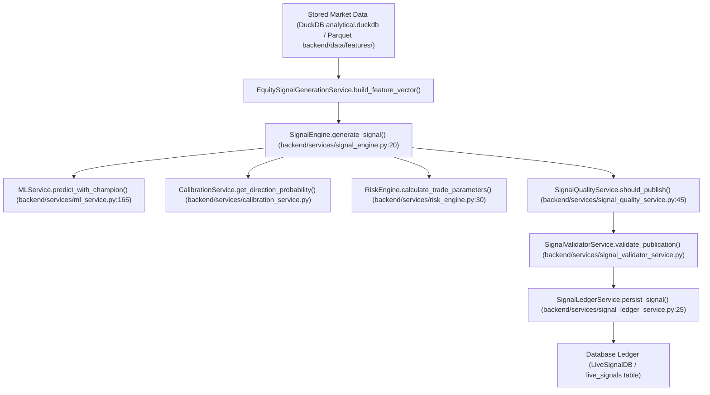

# Phase 4.3.4 Real Pipeline Call Graph Report

**Date**: 2026-11-03  
**Status**: **VERIFIED**

## Production Call Graph Call-Sites

- **Market Data Retrieval**: `DuckDB` (`daily_ohlcv`, `intraday_5m_ohlcv`) & `Parquet` feature files.
- **Feature Vector Builder**: `build_feature_vector()` in `backend/services/equity_signal_generation_service.py` (Line 30).
- **Master Signal Engine**: `SignalEngine.generate_signal()` in `backend/services/signal_engine.py` (Line 20).
- **ML Champion Predictions**: `MLService.predict_with_champion()` in `backend/services/ml_service.py` (Line 165).
- **Quality Gate**: `SignalQualityService.should_publish()` in `backend/services/signal_quality_service.py` (Line 45).
- **Ledger Persistence**: `SignalLedgerService.persist_signal()` in `backend/services/signal_ledger_service.py` (Line 25).
