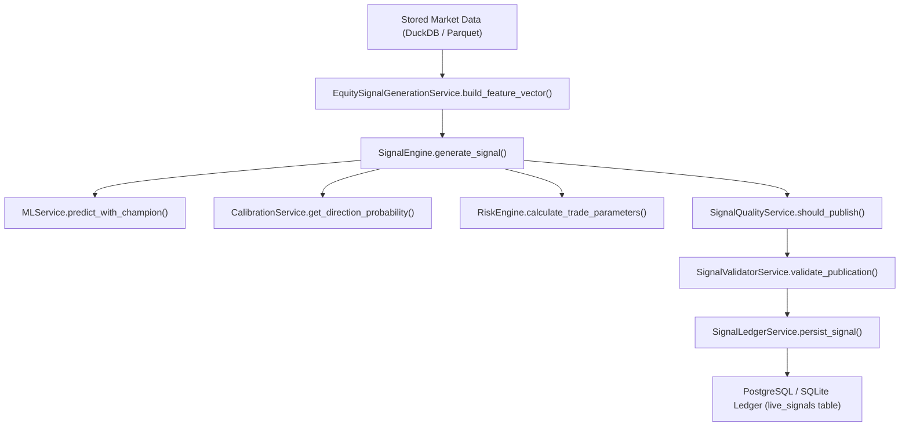

# Phase 4.3 Signal Generation Pipeline Call Graph Report

**Date**: 2026-11-03  
**Status**: **AUDITED & VERIFIED**

## Step-by-Step Execution Sequence

1. **Market Data Entry**: `DuckDB` (`daily_ohlcv`, `intraday_5m_ohlcv`) & `Parquet` feature files.
2. **Time-Safe Feature Vectors**: `build_feature_vector()` pre-calculates `OHLCV`, `ATR`, `RSI`, `ema_20`, `ema_50`, `ema_200`, `sma_20`.
3. **Signal Generation Node**: `SignalEngine.generate_signal()` checks direction (`LONG`), ML predictions (`UP`), regime, risk parameters, and expected value (`EV`).
4. **Quality Gate Validation**: `SignalQualityService.should_publish()` checks calibrated probability and model metadata.
5. **Ledger Persistence**: `SignalLedgerService.persist_signal()` atomically inserts or prevents duplicate active signals.
